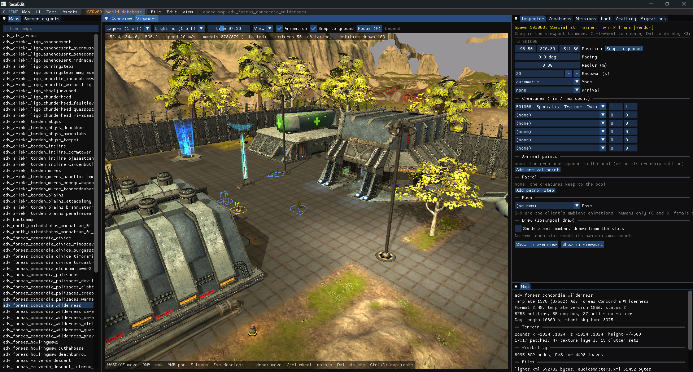

# RasaEdit

A world and content editor for Tabula Rasa.

Create, build and explore visually! Save time on constantly reloading the game world to preview an update.

### AI Coded / Human Verified
> [!NOTE]
> Why AI? I started this project the traditional way and quickly realised that while I could make something functional it was never going to meet the high bar I set for myself. Even with assistance it's taken weeks of debugging, testing and reverse engineering the data structures and rendering to make this a feature complete as possible. I hope that this can also serve as future documentation for other projects that may want to make their own tools.

## Features

- Realm time preview of maps and time of day.
- Create, move and edit creatures, entities and control points interactively.
- Edit Missions, Loot and Crafting recipes.
- Preview and export game assets for editing or import your own.
- Update or preview text for supported languages.
- View and construct UI elements, make new windows and overlays in a WYSIWYG editor.
- Apply updated assets as patches preserving original game data and making undo as easy as deleting a config line.
- Cross platform

## Usage

Run **RasaEdit** and goto **File->Open Game Folder...** and point it at the install directory for the game. Selected a map from the **Maps** pane on the right hand side to start editing and previewing content.

In order to see NPCs, creatures and non-static items you need to also open up a World database using **File->Open Server Database...** and navigating to **rasaworld.db** in the Game Server folder or **File->Connect to MySQL Database...**

Once the world database is loaded you will see objects and other data spawn into view for editing.

The workspace is divided into a <code style="color : lightskyblue">CLIENT</code> side and <code style="color : darkorange">SERVER</code> side. For world building you only need to touch the <code style="color : darkorange">SERVER</code> side, <code style="color : lightskyblue">CLIENT</code> is for making game mods and is a very powerful feature that can potentially break your installation so even though safe guards are in place always backup your data first.